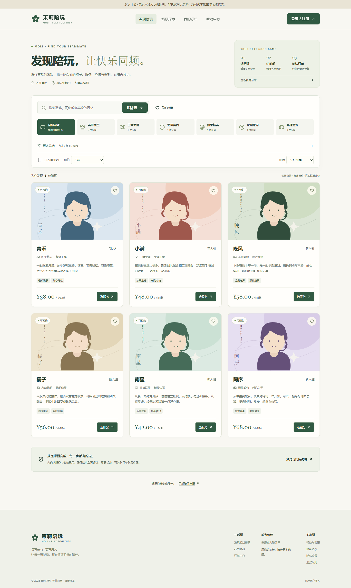
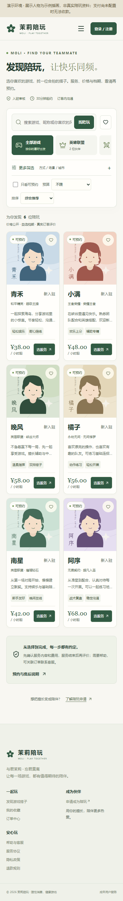
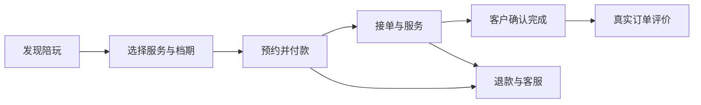

# 茉莉陪玩 · MOLI

**找到合拍的游戏搭子，让每一场游戏都有值得期待的陪伴。**

茉莉陪玩是面向 **客户、客服、陪玩与管理者** 的全栈电竞陪练服务平台。从原有的入职申请与人员展示系统重构而来，保留茉莉绿、暖白色与“与君茉莉 · 忘君莫离”的品牌表达，提供桌面和手机端页面。

[功能概览](#功能概览) · [快速开始](#快速开始) · [演示账号](#演示账号) · [在线支付](#在线支付) · [验证与 CI](#验证与-ci) · [部署与文档](#部署与文档) · [更新说明](CHANGELOG.md)



<details>
<summary>查看手机端页面预览</summary>



</details>

> **项目状态**：四角色协作、本地运行与自动化验证已完成。正式对公众开放前，仍需完成生产部署、真实商户支付联调与运营准备。预览中的人物和资料为演示内容。

## 功能概览

| 角色   | 已实现的功能                                                                                                                       |
| ------ | ---------------------------------------------------------------------------------------------------------------------------------- |
| 客户   | 邮箱注册与验证、登录与找回密码；游戏/价格/关键词筛选；收藏；查看服务与档期；预约付款；订单沟通；确认完成与评价；退款申请；客服工单 |
| 陪玩   | 入驻申请与审核结果；服务介绍与定价；每周档期；暂停接单；接单、拒单、开始与结束服务；订单沟通；收入明细与结算申请                   |
| 客服   | 独立客服工作台；工单回复与沟通历史；解决与追问重开；多人处理冲突保护                                                               |
| 管理者 | 客服授权与撤权；成年身份与技能审核记录；账号与主页管理；订单查看与原路退款；客服工单；结算凭证登记；公告、评价和操作日志           |

### 服务流程



- 北京时间预约，服务时长30分钟至4小时，整点或半点开始；待付款时段锁定15分钟。
- 重叠预约由服务器拒绝；单价、金额与平台服务费在下单时锁定。
- 评分和成交统计来自已完成订单，不伪造演示评价。
- 身份与技能需要运营者实际核验；陪玩结算采用人工转账与凭证登记。

## 技术栈

| 层级   | 技术                                          |
| ------ | --------------------------------------------- |
| 前端   | Vue 3、Vue Router、Vite、Lucide、响应式 CSS   |
| 后端   | Node.js 24、Express、Zod                      |
| 数据库 | 开发使用持久化 SQLite；生产使用 MySQL 8       |
| 支付   | 微信 API v3 Native/H5、支付宝官方 Node.js SDK |
| 测试   | Node.js Test Runner、Supertest、Playwright    |
| 部署   | Docker Compose、Caddy HTTPS、GitHub Actions   |

安全实现包括 scrypt 密码哈希、HttpOnly 会话、角色与订单归属检查、CSRF/来源校验、限流、服务器计价、支付通知验签与幂等记账。

## 快速开始

需要 **Node.js 24 或更高版本**。在仓库根目录统一安装依赖。

### Windows / PowerShell

```powershell
git clone https://github.com/lyx0415/MOLI_PW.git
cd MOLI_PW

npm ci
if (-not (Test-Path .env)) {
    Copy-Item .env.example .env
}
npm run db:migrate
npm run dev
```

### Linux / macOS

```bash
git clone https://github.com/lyx0415/MOLI_PW.git
cd MOLI_PW

npm ci
cp -n .env.example .env
npm run db:migrate
npm run dev
```

打开 **http://localhost:5173**。Vite 将 `/api` 代理到后端 `3000` 端口。访问地址需要与 `PUBLIC_ORIGIN` 一致，更换地址时同步更新配置。开发数据库位于 `data/moli.sqlite`，无需预装 MySQL。

## 演示账号

默认安装没有示例人员。在本地 `.env` 中设置 `DEMO_MODE=true`，并将 `DEMO_PASSWORD` 设为自行选择的临时密码（至少10位，包含英文字母和数字），然后运行：

```powershell
npm run demo:seed
```

| 角色   | 邮箱                                                     | 入口                  |
| ------ | -------------------------------------------------------- | --------------------- |
| 客户   | `customer@demo.moli.test`                                | `/account`、`/orders` |
| 陪玩   | `provider1@demo.moli.test` 至 `provider6@demo.moli.test` | `/studio`             |
| 管理者 | `admin@demo.moli.test`                                   | `/admin`              |
| 客服   | `support@demo.moli.test`                                 | `/support`            |

演示账号使用你设置的 `DEMO_PASSWORD`。演示播种只允许开发环境，生产应使用全新数据库。插画和资料为示例，不代表真实陪玩照片。

### 创建真实管理员

在受保护的服务器环境中临时设置 `ADMIN_EMAIL`、`ADMIN_PASSWORD` 和可选 `ADMIN_NAME`，运行 `npm run admin:create`。该命令不会覆盖已有账号；初始化后移除临时密码配置。

## 在线支付

- **微信 Native**：桌面展示二维码，使用微信扫码付款。
- **微信 H5**：商户开通 H5 并登记域名后，手机系统浏览器可以调起支付。
- **支付宝**：电脑网站与手机网站支付，使用官方 SDK 和 RSA2 验签。

配置商户号、AppID、私钥、验签公钥信息等字段后启用，详见 [支付配置](docs/PAYMENTS.md)。**密钥未配置时，前台在线支付及预约入口不会开放。** 网页回跳不等于付款成功，订单只根据验签通知或签名查单更新；退款按支付渠道的确认结果显示。

微信内置浏览器当前使用扫码方案，尚未实现公众号 OAuth/OpenID/JSAPI。支付测试不进行真实扣款。

## 常用命令

| 命令                   | 用途                           |
| ---------------------- | ------------------------------ |
| `npm run dev`          | 同时启动前后端开发服务         |
| `npm run build`        | 前端生产构建                   |
| `npm start`            | 启动后端并提供已构建的前端页面 |
| `npm run db:migrate`   | 版本化数据库迁移               |
| `npm run demo:seed`    | 初始化开发演示资料             |
| `npm run admin:create` | 创建真实管理员                 |
| `npm test`             | 后端业务、账号与支付测试       |
| `npm run test:e2e`     | 浏览器业务流程                 |

使用 `npm start` 提供页面时，需将 `PUBLIC_ORIGIN` 设为实际访问地址。生产反向代理配置见部署文档。

## 验证与 CI

当前验证：**29项后端/支付/邮箱测试**、SQLite/MySQL 业务回归、**6条浏览器流程**、前端生产构建、24会话有限负载及 Docker 构建/运行检查通过。npm 官方生产依赖审计为零已知漏洞。范围与公开上线前的剩余事项见 [发布审查](docs/RELEASE_REVIEW.md)。

```powershell
npm test
npm run build
npm run test:e2e
npm audit --omit=dev --registry=https://registry.npmjs.org
```

浏览器测试默认使用 Microsoft Edge。使用 Chromium 时，先运行 `npx playwright install chromium` 并设置 `PLAYWRIGHT_CHANNEL=chromium`。

MySQL 回归使用专用测试实例，通过 `TEST_DB_DRIVER=mysql`、`TEST_DB_PORT`、`TEST_DB_USER`、`TEST_DB_PASSWORD` 配置。测试需要建库权限，会创建并删除独立的 `moli_qa_*` 数据库。

支付测试使用生成的密钥、受控响应和隔离适配器，不访问真实收款流程。详细范围见 [验收记录](docs/ACCEPTANCE.md)。

## 项目结构

```text
backend/
  app.js                 HTTP、鉴权、CSRF 与错误处理
  lib/                   配置、校验、数据库和订单领域逻辑
  migrations/            版本化迁移及校验和
  payments/              微信 API v3 / 支付宝适配器
  routes/                账号、发现、业务、管理及支付
  scripts/               管理员、迁移、维护与演示播种
  test/                  后端与支付测试
frontend/src/
  components/            品牌、插画、陪玩卡片与分页
  lib/                   请求、账号及站点状态
  views/                 公开页面与三角色工作台
deploy/                  HTTPS 网关配置
tests/e2e/               浏览器业务流程
docs/                    架构、支付、部署、迁移与验收
```

## 部署与文档

生产需要 MySQL、HTTPS、SMTP、真实运营信息与商户配置。提供的 Docker Compose 使用 Node.js、MySQL 和 Caddy，按单 API 实例部署。

| 文档                               | 内容                                         |
| ---------------------------------- | -------------------------------------------- |
| [部署说明](docs/DEPLOYMENT.md)     | Docker、域名/HTTPS、邮件、管理员、备份与运维 |
| [支付配置](docs/PAYMENTS.md)       | 微信/支付宝参数、签名、回调、查单与退款      |
| [架构说明](docs/ARCHITECTURE.md)   | 授权、订单状态、金额、并发与功能边界         |
| [旧数据迁移](docs/MIGRATION.md)    | 数据保留、账号核验、切换与回退               |
| [发布审查](docs/RELEASE_REVIEW.md) | 四角色能力、已修问题、稳定性证据和上线条件   |
| [验收记录](docs/ACCEPTANCE.md)     | 验证结果及上线所需外部条件                   |
| [更新说明](CHANGELOG.md)           | 本次重构内容                                 |
| [提交说明](docs/COMMIT_MESSAGE.md) | 重构目标、主要变更与验证结果                 |

新表使用 `moli_` 前缀，原 `applications`、`players` 表保留。旧陪玩需要注册并核验后绑定新平台，不自动分发默认登录密码。

现已扩展线上电竞及线下电竞、健身陪练、KTV、桌游、棋牌场景；详见 [多场景运营说明](docs/EXPERIENCES.md)。线下项目需经人工审核再开放预约。结算由运营者人工转账；尚未实现自动分账、音视频通话、文件上传或微信内 JSAPI。Docker 与真实商户公网联调需要在目标环境完成。

`.env`、演示数据库、运行日志及商户密钥不在仓库中。历史公开过的旧密码需在原环境更换。
