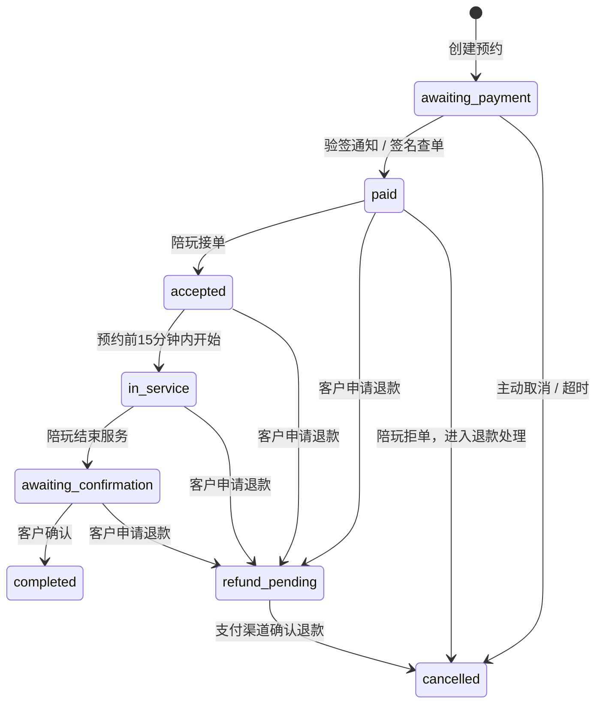

# 架构与业务约定

## 技术边界

Vue + Vue Router 负责界面，Express 负责业务与授权，生产数据存储在 MySQL 8。SQLite 用于本地开发与独立测试。新表均使用 `moli_` 前缀；原 `applications`、`players` 表不会被修改或删除。

网站以线上电竞陪练为首版服务范围。旧站线下健身和娱乐类别保留在旧数据中，不自动开放预约。公开介绍只显示服务信息，不显示联系方式。品牌、人物占位插画与页面结构使用项目自有实现。

## 角色与授权

注册账号默认是 `customer`，客户端传入的角色不会采纳。陪玩入驻通过后获得 `provider` 身份，同时继续保留客户功能；`admin` 只能通过服务器初始化命令建立。所有授权在服务器执行，前端路由仅用于引导。

`support` 是独立客服角色，由管理员授予已验证邮箱的正常客户账号。客服工作台仅允许查看和处理客服工单；订单资金、结算、审核及账号管理仍属于管理员。授权与撤权都会终止目标账号的旧会话并记录审计。工单采用追加式历史，回复/追问携带已读版本，冲突返回 409；追问自动重开已解决工单。

密码使用带随机盐的 scrypt；会话采用加密随机 token，数据库只保存 token 摘要。Cookie 为 HttpOnly / SameSite=Lax，生产启用 Secure；写操作验证来源与 CSRF。会话具有固定有效期；重设密码、停用账号会终止相关会话。正式注册与找回密码需要邮件验证码。

入驻成年身份与技能核验是运营者的人工工作。审核页面记录核验确认，不声称已接入第三方实名服务，也不在公开页面收集身份证文件。

## 订单状态

拒绝退款申请时恢复申请前的服务状态，并向客户显示处理原因。完成后的争议通过客服工单处理，不开放绕过资金核对的任意状态修改。

`refund_pending` 在退款请求及渠道处理中持续占用原档期。确认退款后释放；拒绝退款前再次锁定陪玩并核对冲突，避免恢复旧版本遗留的重叠预约。

## 预约与并发

- 北京时间，每周档期按星期和分钟记录；每单30分钟至4小时，整点或半点开始，不跨午夜。
- 提前至少30分钟，最多提前30天；待付款锁定时段15分钟；一个客户最多3个有效待付款预约。
- MySQL 事务使用 READ COMMITTED，并锁定客户与陪玩记录以串行核对预约冲突；锁等待和死锁可以有限重试。
- SQLite 事务在单进程内串行执行。生产不开放 SQLite 模式。
- 金额全部用整数“分”记录。单价、时长、总价、平台服务费、陪玩收入在下单时锁定。

## 支付与退款

订单只允许一个支付渠道和支付模式，防止跨设备切换导致同订单重复创建不同场景交易。服务端计算金额，付款和退款需确认对应商户与订单。微信请求和应答均签名/验签，通知解密后校验金额、币种、AppID 与商户号；支付宝使用官方 SDK，采用 RSA2、公钥模式及响应验签。

付款通知在事务内校验，重复通知只记录一次。已关闭或超时订单收到付款时保留资金事实，并进入退款申请队列。退款使用稳定的商户退款单号；超时重试复用该号码，不新建一笔退款。首版只支持整单原路退款。

只有完成、已付款且无退款争议的订单进入陪玩可结算收入。结算申请锁定对应金额；管理员在外部转账完成后登记凭证。这里没有把“登记”当成自动向陪玩转账；未来可单独对接合规的商户分账/转账产品。

## 运维范围

当前 Compose 按单 API 实例部署，内存限流适用于该规模；扩为多实例前需要共享限流存储与迁移互斥。站内消息为订单文本沟通，展示最近50条，不提供公开聊天室、音视频通话或即时推送。邮箱只用于验证码与找回密码。

已登录 API 额度按账号隔离，匿名额度按 IPv4/IPv6 地址计数，敏感认证接口另按 IP 限流。后台列表与个人工单返回分页对象；工单历史可翻页。2026-10-22 的测试证据和生产限制见 [发布审查](RELEASE_REVIEW.md)。

没有上传用户文件、虚构评价、余额充值、赌博和代练账号交易。真实头像/声音展示、短信、JSAPI/OAuth、自动分账、移动应用和复杂优惠券可作为后续独立功能。

## 页面参考

借鉴公开产品的游戏分类、技能服务、陪玩筛选与客服入口，结合原茉莉绿品牌。页面、花形标识和占位插画均为本项目实现，没有复制竞品商标、人物素材或具体源码。

- [猎游官网](https://www.lieyou.com/)：电竞陪练与服务分类、客服入口。
- [比心官方应用介绍](https://apps.apple.com/cn/app/id1286964732)：游戏陪练服务与技能展示。
